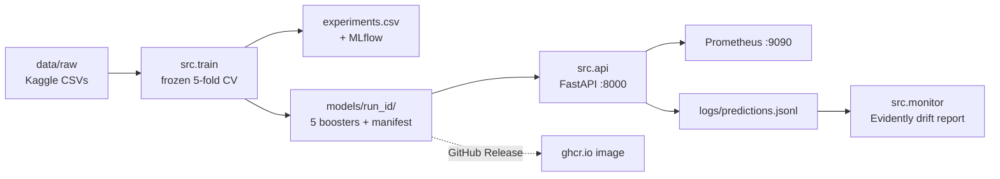

# Customer churn: from a Kaggle model to a served API

A churn model for Kaggle's [Playground Series S6E3](https://www.kaggle.com/competitions/playground-series-s6e3)
(a 594,194-row synthetic expansion of the Telco churn table, scored by ROC-AUC),
and the production pipeline built around it: experiment tracking, a versioned
model bundle, a FastAPI service, Docker, CI/CD, drift monitoring and data
versioning. Everything is open source; each tool choice is written up with its
Azure equivalent in [`docs/adr/`](docs/adr/README.md).

The repo is two things that share one codebase. The **competition workflow**
measures models against a frozen cross-validation scheme and logs every run.
The **production pipeline** takes the model that workflow selected and serves
it, with a test proving the serving path computes exactly what training did.

## Where it stands

| | Run | CV (OOF AUC) | Public LB |
|---|---|---|---|
| **Served model** — LightGBM, 21 features, average of 5 fold models | `0904_202729_lgbm` | 0.916391 | 0.91393 |
| Best leaderboard score — LightGBM + CatBoost blend | `0904_210905_blend` | 0.916567 | 0.91401 |
| Baseline | `0902_232045_lgbm` | 0.916296 | 0.91389 |

The blend scores higher but isn't served: its +0.000176 is smaller than what the
public leaderboard can resolve, and it would mean a second model to version and
88MB of CatBoost in the image. The served bundle, `models/1024_141318_lgbm`, is the
champion retrained so its fold models are saved; it reproduces the champion's
predictions **bitwise**, so it is provably the model behind LB 0.91393.

Everything tried, kept or dropped is in [`experiments.md`](experiments.md),
including a **Dead ends** table. Cross-validation is stratified 5-fold, decided
on 2026-09-02 from measurements and frozen since: every saved prediction carries
fold fingerprint `13feb807`, and CI fails if it changes.

## How it fits together



[`docs/architecture.md`](docs/architecture.md) walks through each hop and what
is guaranteed at it.

## Quick start

You need [uv](https://docs.astral.sh/uv/), Docker for the full stack, and a
Kaggle API token for the data. On macOS, LightGBM also needs OpenMP:
`brew install libomp`.

**1. Install** the locked environment and the git hooks:

```bash
make setup
```

**2. Get the data.** Put your Kaggle token at `~/.kaggle/kaggle.json`
(Kaggle → Settings → API → Create New Token, then `chmod 600` it), then:

```bash
make data
```

**3. Check everything works.** 92 tests, none of which need the data — the ones
that do skip themselves when it's absent:

```bash
make test
```

**4. Train a model you can serve.** About two minutes. This writes the fold
models and their manifest to `models/<run_id>/`, logs a row to
`experiments.csv` and a run to MLflow:

```bash
uv run python -m src.train --model lgbm --full-refit --notes "serving bundle"
```

**5. Tell the API which model to serve.** Copy the example env file and set
`MODEL_RUN_ID` to the run id the last step printed (or `ls models/`):

```bash
cp .env.example .env
```

**6. Serve it**, on the host with reload:

```bash
make serve
```

Open <http://localhost:8000> for a small form, or <http://localhost:8000/docs>
for the API contract. To score one customer from the command line:

```bash
curl -X POST localhost:8000/predict -H 'Content-Type: application/json' -d @tests/fixtures/example_request.json
```

It returns a churn probability and a risk band (`high` is the top 10% of
scored customers), not a yes/no decision — see [`docs/serving.md`](docs/serving.md).

**7. Or run the full stack** in Docker — the API, an MLflow UI and Prometheus:

```bash
make up
```

| Service | URL |
|---|---|
| API | <http://localhost:8000> |
| MLflow | <http://localhost:5001> |
| Prometheus | <http://localhost:9090> |

Stop it with `make down`.

**8. Check for drift** between what the API has been sent and the training data.
Build the baseline once, then report as often as you like:

```bash
make reference
make drift
```

Every command, including blending, submitting and Kaggle kernels, is in
[`CHEATSHEET.md`](CHEATSHEET.md).

## Things that will trip you up

- **MLflow is on port 5001, not 5000.** macOS's AirPlay Receiver holds 5000.
- **The API won't guess which model to serve.** With more than one bundle in
  `models/` and no `MODEL_RUN_ID`, `/ready` returns 503 and names the
  candidates; `/health` stays up.
- **Models and data are not in git.** Data comes from Kaggle; a model bundle is
  ~30MB against a 1MB commit limit, so it's trained locally or downloaded from a
  GitHub Release.
- **Run `make up` from the repo root.** The MLflow container mounts `mlruns/` at
  the same absolute path the host uses, because MLflow stores absolute artifact
  paths.
- **After a training run, run `make dvc-save`.** `experiments/` is versioned with
  DVC, and a new run makes `dvc status` dirty until it's re-added.
- **Don't touch `CV_SCHEME`, `N_FOLDS` or `src/cv.py`.** Every saved prediction
  depends on them; `tests/test_cv.py` fails if the fold fingerprint moves.

## Working on the model

One change per run, always with `--notes` saying what changed, so the OOF
difference between two runs means something. Every run writes
`experiments/oof_<run_id>.npy` and `experiments/test_<run_id>.npy` — **keep them
all**: `src.blend` optimises weights over saved predictions, and a deleted
`.npy` is a model you have to retrain.

Two files hold the history, and only one is automatic:

- `experiments.csv` — the numbers, appended by `src.train`. After submitting,
  `uv run python -m src.log_lb <run_id> <score>` records the public LB score and
  says whether CV and LB agree.
- `experiments.md` — the reasoning: hypothesis, result, keep or drop. Nothing
  writes it for you. Read its **Dead ends** before trying anything.

What moves the score, roughly in order of value per hour, and what this repo
found about each:

1. **A CV scheme that mirrors the test split.** Here, adversarial validation of
   train against test scored AUC 0.5117 — the same distribution — so stratified
   folds are right, and CV has tracked the leaderboard at a steady offset.
2. **Features that encode domain structure.** Two charge ratios earned
   +0.000095, positive in 5 of 5 folds; a service count and a tenure bucket
   earned nothing.
3. **A blend of different models.** It only pays if the other model is close to
   as good: CatBoost blended for +0.000176, while a logistic regression and an
   MLP, though more different, got 0.4% and 0.001% of the weight.
4. **Hyperparameter tuning.** Last, and not yet tried.

[`learnings.md`](learnings.md) explains the measurement techniques behind these
— univariate AUC, adversarial validation, and judging whether a CV difference
is real.

## Releasing a model

Shippable images are built from a model attached to a GitHub Release, never
from git:

```bash
make release-bundle RUN_ID=1024_141318_lgbm
gh release create v1.0.0 dist/bundle-1024_141318_lgbm.tar.gz --notes "OOF 0.916391"
```

Publishing the release triggers CD, which builds the image with that bundle,
pushes it to `ghcr.io/nbegumc/predict-customer-churn`, then pulls it back and
smoke-tests it. CI runs lint, the tests and a container smoke test on every pull
request, using a throwaway model trained on a 200-row fixture. Hosting the image
is documented but not built — see [`docs/deployment.md`](docs/deployment.md).

## Repo map

```
src/
  config.py      every path and setting; the frozen CV scheme
  data.py        load and clean
  features.py    the engineered features
  cv.py          the fold splitter and the metric (frozen)
  train.py       the one way to train: folds, OOF, bundle, logging
  models/        lgbm, catboost, linear, mlp wrappers
  blend.py       weight saved runs on their OOF predictions
  log_lb.py      record a public leaderboard score
  predict.py     the one inference path, parity-tested against training
  api.py         the FastAPI service
  monitor.py     drift reports against the training data
notebooks/       EDA, baseline, serving-strategy comparison, final write-up
tests/           92 tests; fixtures/ holds a 200-row synthetic dataset
docs/            architecture, serving, deployment, 12 ADRs, Azure mapping
experiments.md   why each run was kept or dropped
learnings.md     the statistics behind the decisions
```

## Further reading

- [`docs/adr/`](docs/adr/README.md) — twelve decisions, each with its Azure
  equivalent and what it would cost to change. Start with
  [0012](docs/adr/0012-train-serve-parity.md) before changing feature code: three
  bugs live in the gap between training and serving, and that ADR measures each.
- [`docs/azure-mapping.md`](docs/azure-mapping.md) — every tool here and what
  changes to run it on Azure. Most of it is one environment variable.
- [`notebooks/99_final_writeup.ipynb`](notebooks/99_final_writeup.ipynb) — the
  model in business terms: who to call first, and how far down the list to go.

## Working in Kaggle kernels (for their GPU)

`src/` is pushed up as a Kaggle utility dataset and imported in the kernel:

```python
import sys; sys.path.append('/kaggle/input/<your>-utils')
from src.train import run
```

`bash scripts/sync_utils_to_kaggle.sh` pushes a new version. `src/config.py`
detects `/kaggle/input` and redirects the paths, so nothing else changes.
Kernels run without internet, so MLflow isn't installed there; training
carries on and tracking falls back to a no-op.
