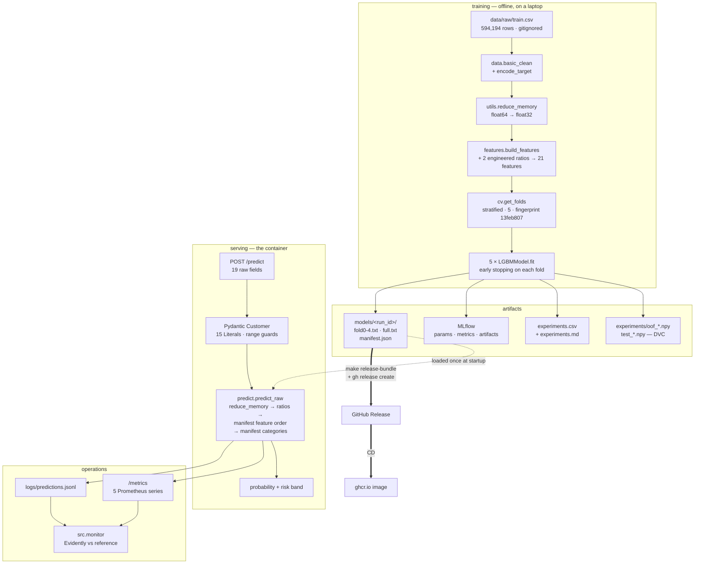

# Architecture

How a row of raw customer data becomes a scored prediction, and what is
guaranteed at each hop.

## The pipeline

## The two paths must agree, and are tested to

The training path and the serving path compute the same 21 features through
**the same functions in the same order**. That is not a style preference; three
specific bugs live in the gap between them, and
[ADR 0012](adr/0012-train-serve-parity.md) records all three with measurements.

The guarantee is bitwise: `tests/test_predict.py` scores all 254,655 rows of
`data/raw/test.csv` through the bundle and asserts the result equals
`experiments/test_<run_id>.npy` exactly. Not `allclose` — a tolerance cannot
tell a real feature bug from rounding.

Two things the serving path deliberately does **not** call:

| | why not |
|---|---|
| `data.basic_clean` | ends in `drop_duplicates()` — three identical customers in a batch become one row, and the response misaligns with the request |
| `features.build_features` | calls `as_categorical`, which rebuilds category lists *from the request*; LightGBM encodes categoricals as integer codes, so the codes would be wrong |

## What the manifest carries

The model file independently records its feature order and category lists, so
`manifest.json` is a **cross-check**, not a thing to trust — `load_bundle`
refuses a bundle where the two disagree. What lives only in the manifest:

- `strategies` — a name → weighted member list. `fold_average` is five members
  at 0.2; `full_refit` is one at 1.0. One code path at inference, and a future
  blend is an appended member.
- `dtypes`, `raw_columns`, `best_iterations`, `score_quantiles` (the risk-band
  thresholds), `cv_score`, `fold_fingerprint`, `git_sha`.

## The invariant that holds it together

`CV_SCHEME`, `N_FOLDS` and `src/cv.py` are frozen. Every saved `oof_*.npy`
carries fold fingerprint `13feb807`, and `blend.py` refuses to average files
produced under different folds. `tests/test_cv.py` reproduces that fingerprint
from a label-only frame — **no data required** — so CI enforces it on every PR.

## Where each decision is written down

Twelve ADRs in [`docs/adr/`](adr/README.md), each with its Azure equivalent.
Start with [0012](adr/0012-train-serve-parity.md) if you are going to change
feature code, and [0002](adr/0002-fold-average-over-refit.md) if you want to
know why the served model is the one it is.
