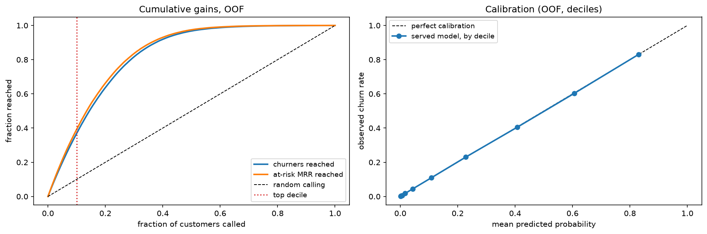
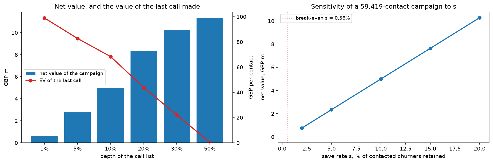

# The use case: a revenue-ranked retention campaign

What this model is for, what it is worth, and how we would know whether it
worked. Every figure below is reproduced by
[`notebooks/04_business_case.ipynb`](../notebooks/04_business_case.ipynb) from
the saved out-of-fold predictions of the bundle the API serves — nothing here is
a fresh fit, and nothing is quoted from memory.

**One-line version:** churn costs this operator **£10.9M of monthly recurring
revenue**; the served model finds **39% of it in the top 10% of a ranked call
list**; a campaign on that list breaks even at a **0.56% save rate**; and the
only honest way to learn the real save rate is a **randomised holdout, which a
10% control arm can resolve.**

---

## 1. The decision being supported

A retention team has limited agent hours and a fixed offer budget. Each month it
works a ranked call list from the top down until the hours run out. The model
supplies the ranking.

That operational shape is why the model was selected on ROC-AUC rather than
accuracy. Accuracy asks whether a 0.5 threshold falls on the correct side, which
nobody acts on — at a 22.5% base rate, predicting "nobody churns" is 77.5%
accurate and supports no decision at all. AUC asks whether a churner is ranked
above a non-churner, which is exactly the question a call list asks.

The service is already shaped for this. `POST /predict` returns a probability and
a `risk_band`, where `high` is the top 10% of the scored population — the same
segment this document costs out. It deliberately does **not** return a yes/no
decision; see [`serving.md`](serving.md).

## 2. The problem, in money

A churn rate is a headcount statistic, and headcount is not what an operator
loses. Measured on the 594,194-customer training table:

| | |
|---|---|
| Customers | 594,194 |
| Churn rate, headcount | 22.52% |
| Churn rate, **revenue** | **27.90%** |
| Monthly recurring revenue | £39,137,315 |
| **MRR carried by churners** | **£10,919,136 / month** |
| ARPU, churners | £81.60 |
| ARPU, non-churners | £61.29 |
| Revenue weighting | **1.33×** |

**Churn is revenue-weighted against the operator.** The customers leaving pay a
third more than the ones staying, so churn takes 27.9% of revenue while taking
22.5% of customers. The budget is set against £10.9M/month, not against "22.5%".

This also means *whom to call* has two dimensions — how likely someone is to
leave, and what their leaving costs. §5 prices the second one.

## 3. What the ranking buys

At each call-list depth, on out-of-fold predictions (OOF AUC **0.916391**):

| Call the top | Customers | Precision | Churners reached | Lift | At-risk MRR reached |
|---|---|---|---|---|---|
| 1% | 5,941 | 95.8% | 4.3% | 4.26× | 4.6% |
| 5% | 29,709 | 89.6% | 19.9% | 3.98× | 21.4% |
| **10%** | **59,419** | **83.1%** | **36.9%** | **3.69×** | **39.2%** |
| 20% | 118,838 | 71.7% | 63.7% | 3.18× | 66.3% |
| 30% | 178,258 | 61.3% | 81.7% | 2.72× | 83.6% |
| 50% | 297,097 | 43.6% | 96.8% | 1.94× | 97.5% |

Calling the top tenth of the base reaches **more than a third of everyone who
will churn, and 39% of the revenue they carry** — 3.7× what calling 10% at random
would reach.



## 4. Turning a probability into a decision

The model returns a probability. Spending money needs a threshold, and no
threshold was ever chosen during model selection — picking one is a budget
decision, not a model property.

Writing down the economics chooses it without anyone guessing. For a customer
with churn probability `p` and monthly revenue `m`, where `c` is the cost of one
contact, `s` the share of contacted churners actually retained, and `H` the
months a saved customer stays:

```
E[contact] = p · s · m · H  −  c         →  contact if  p · m  >  c / (s · H)
```

Note the threshold falls on the **product `p · m`**, not on `p`.

**This step is only legitimate because the model is calibrated**, which the
notebook measures rather than assumes: mean predicted churn 0.22517 against an
observed 0.22521, and in the top decile 0.8302 predicted against 0.8306 observed
(Brier 0.09505 vs 0.17449 for a constant forecast — skill score 0.455). AUC would
not have caught a failure here, since it is invariant to any monotone rescaling.
Had the check failed, the fix would be isotonic calibration fitted on OOF, not a
hand-picked cutoff.

### Assumptions

Three numbers are **not** measured in this repo. They are isolated in one cell of
the notebook so they can be replaced:

| | value | what it is |
|---|---|---|
| `c` | £5.00 | cost of one outbound contact, including offer admin |
| `s` | 10% | share of contacted churners actually retained — **the unknown** |
| `H` | 12 months | how long a saved customer stays |

### How deep to call

Ranked by expected value, at `c = £5`, `s = 10%`, `H = 12`:

| Depth | Contacts | Revenue retained | Net | ROI | Cost per save | EV of the *last* call |
|---|---|---|---|---|---|---|
| 1% | 5,941 | £644k | £615k | 21.7× | £54 | £99 |
| 5% | 29,709 | £2.91M | £2.76M | 19.6× | £58 | £83 |
| **10%** | **59,419** | **£5.29M** | **£4.99M** | **17.8×** | **£62** | **£68** |
| 20% | 118,838 | £8.91M | £8.31M | 15.0× | £71 | £44 |
| 30% | 178,258 | £11.1M | £10.2M | 12.5× | £83 | £22 |
| 50% | 297,097 | £12.8M | £11.3M | 8.6× | £115 | £0.33 |



**Read the last two columns, not the third.** Net value keeps rising to 50% depth,
so an unconstrained campaign would call half the base. But the *marginal* call
collapses from £99 to £0.33 and cost per save doubles. With limited agent hours,
an hour spent at 30% depth is worth a third of an hour spent at 1%. **Go shallow
and deepen the offer, not the list.**

**And the go/no-go does not depend on the unknown.** Break-even at 10% depth is a
**0.56% save rate — one save per 178 contacts.** Any plausible `s` makes the
campaign profitable; `s` sets the size of the prize, not the sign.

## 5. Rank by value, not by risk

The model hands over a list ordered by probability. §4's rule says to order by
`p · m`. Same 59,419 contacts, reordered:

| Ranked by | Precision | Churners reached | At-risk MRR reached | Expected net value |
|---|---|---|---|---|
| probability `p` | 83.06% | 36.88% | £4,284,329 | £4,842,605 |
| **expected value `p · m`** | 81.36% | 36.12% | **£4,410,050** | **£4,991,649** |
| difference | −1.70pp | −0.76pp | **+£125,721 / month** | **+£149,043** |

This is the clearest case in the repo of a model metric and a business metric
disagreeing. The value-ranked list is **worse at what the model was scored on and
better at what the campaign is for**, because it trades cheap near-certain
churners for expensive probable ones. Selecting on AUC alone would never surface
it, and applying it costs nothing — `monthlycharges` is already in the request the
API receives.

*Caveat:* `m` is current monthly revenue, a proxy for lifetime value. A real
deployment would use margin, and a tenure-dependent horizon rather than a flat 12
months. Both refine the same rule.

## 6. How the effect is measured

Everything above is an **expectation** computed from held-out predictions. None of
it is evidence that calling anyone prevents churn. The model ranks who is *at
risk*; a campaign needs who is *persuadable*, and those are different people — a
customer who will leave whatever you do and one who can be talked round look
identical to a model fitted on observational data.

Measurement therefore runs in four tiers, and three of them already exist here:

| Tier | Question | Metric | Status |
|---|---|---|---|
| **Model** | Does it rank risk? | OOF AUC, lift@k, calibration | **Built** — `experiments.csv`, `src.log_lb`, notebook 04. Folds frozen at fingerprint `13feb807`; `tests/test_cv.py` fails if it moves |
| **Decision** | Is the campaign worth running? | Net value, ROI, cost per save, break-even `s` | **Built** — notebook 04 §4–5; recompute when `c`, `s` or `H` change |
| **Effect** | Did contacting them help? | Churn difference vs a randomised holdout, realised saves, revenue retained | **Not built** — needs the experiment below |
| **System** | Is it still working? | `churn_predictions_total`, `churn_prediction_latency_seconds`, `churn_predicted_probability`, `churn_out_of_range_inputs_total{field}` | **Built** — `/metrics` → Prometheus; `make drift` for input drift |

### The experiment the third tier needs

Withhold contact from a random share of the ranked list and compare observed
churn between the arms. Sizing, at 80% power and 5% two-sided, against the 83.06%
churn rate observed in the called decile:

| Detect | Implied save rate `s` | Customers per arm | Holdout as % of a 59,419-contact campaign |
|---|---|---|---|
| 1pp | 1.2% | 22,603 | 38.0% — not viable |
| **2pp** | **2.4%** | **5,774** | **9.7%** |
| 3pp | 3.6% | 2,620 | 4.4% |
| 5pp | 6.0% | 980 | 1.6% |

**A 10% holdout resolves a 2pp reduction** — an `s` of about 2.4%, comfortably
between the 0.56% break-even and the 10% assumed in §4. That design can tell
"worth running" from "not worth running". A 1pp effect would need a 38% holdout,
which no business will agree to; effects that small are not measurable at this
campaign size, and it is better to say so upfront than to promise them.

### What this implies about where to spend effort

A tier-1 gain of +0.0002 AUC sits below this setup's noise floor
([`learnings.md`](../learnings.md): ±0.00007 on a paired comparison) and changes
no decision in the tables above. A tier-3 measurement of `s` moves the campaign's
value across the whole range in §4's sensitivity panel. **The cheapest remaining
improvement is not a better model.**

## 7. What this does not license

- **The data is synthetic** — a generated expansion of the Telco table. The
  £10.9M, the 1.33× weighting and everything derived from them are arithmetic on
  a generator's output. The method transfers; the figures do not.
- **£5, 10% and 12 months are assumptions, not findings**, which is why they live
  in one cell. Only `s` changes the decision rather than its size.
- **Nothing here is causal.** Month-to-month contracts rank as the strongest risk
  driver ([notebook 99](../notebooks/99_final_writeup.ipynb) §5), but contract
  type is partly a *consequence* of intent to stay — migrating someone to an
  annual contract need not lower their risk.
- **No repeat-contact suppression is possible.** This dataset has no
  `customerid`, so a deployment would need contact history the model has never
  seen: someone called three times this quarter should not be called again
  because their score is still high.
- **A probability is still not a decision.** The threshold derived in §4 belongs
  to the campaign that spends the budget, not to the service. `src/api.py` keeps
  returning `churn_probability` and a `risk_band` — see [`serving.md`](serving.md)
  for why that separation is deliberate.

---

## Reproducing every number here

```bash
make data                                    # Kaggle CSVs into data/raw/
uv run jupyter lab notebooks/04_business_case.ipynb
```

The notebook asserts that the served bundle's OOF predictions are **bitwise
identical** to champion run `0904_202729_lgbm` before computing anything, so the
business case describes the model that actually scored public LB 0.91393 — not a
re-fit that resembles it.
